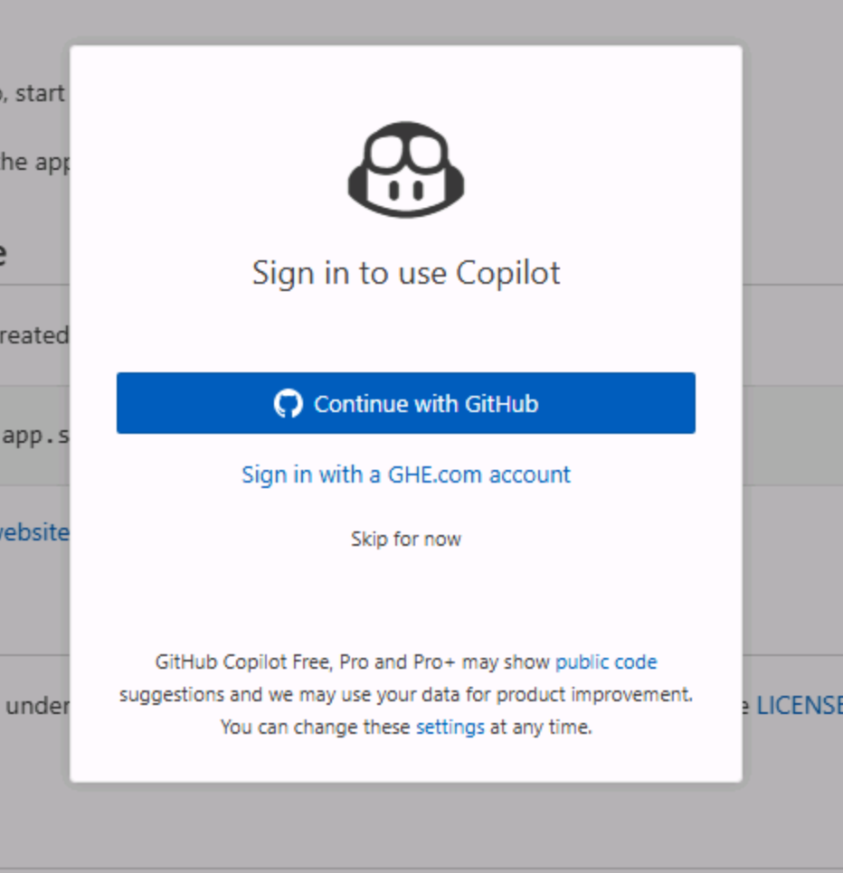

Antes de empezar los ejercicios de VS Code, tienes que dejarlo todo preparado. Crearás tu propia copia del repositorio de Tailspin Toys, pondrás en marcha un [codespace][codespaces] para trabajar en él y confirmarás que GitHub Copilot Chat funciona en tu editor.

## Configurar el repositorio del laboratorio

Para crear una copia del repositorio con el código que vas a generar, crearás una instancia a partir de la [plantilla][template-repository]. La nueva instancia contendrá todos los archivos necesarios para el laboratorio y la utilizarás a lo largo de los ejercicios.

1. En una ventana nueva del navegador, ve a la [plantilla de Tailspin Toys][tailspin-template].
2. Crea tu propia copia del repositorio seleccionando el botón **Use this template** en la página del repositorio del laboratorio. Después, selecciona **Create a new repository**.

    

3. Si realizas el taller como parte de un evento dirigido por GitHub o Microsoft, sigue las instrucciones de los mentores. En caso contrario, puedes crear el nuevo repositorio en una organización en la que tengas acceso a GitHub Copilot.

    

4. Anota la ruta del repositorio que has creado (**nombre-de-la-organización-o-usuario/nombre-del-repositorio**), porque la necesitarás más adelante en el laboratorio.

> [!NOTE]
> **Tu lista de trabajo pendiente está lista**
>
> Al crear tu repositorio a partir de la plantilla, se genera automáticamente una lista de incidencias de GitHub. Trabajarás a partir de estas incidencias durante todo el taller; no tienes que registrar nada tú mismo.

## Crear un codespace

A continuación, usarás un codespace para completar los ejercicios del laboratorio.

[GitHub Codespaces][codespaces] es un entorno de desarrollo en la nube que permite escribir, ejecutar y depurar código directamente en el navegador. Ofrece un IDE completo con compatibilidad con varios lenguajes de programación, extensiones y herramientas.

1. Ve al repositorio que acabas de crear.
2. Selecciona el botón verde **Code**.

    

3. Selecciona la pestaña **Codespaces** y, después, el botón **+** para crear un codespace nuevo.

    

La creación del codespace tardará varios minutos, aunque sigue siendo mucho más rápido que instalar manualmente todos los servicios. Mientras tanto, puedes aprovechar para explorar otras funcionalidades de GitHub Copilot, de las que nos ocuparemos a continuación.

> [!CAUTION]
> Volverás al codespace en un ejercicio posterior. Por ahora, déjalo abierto en una pestaña del navegador.

> [!NOTE]
> Este taller está diseñado para ejecutarse en un codespace o en un [contenedor de desarrollo][dev-containers] local. Ambos garantizan que el entorno tenga instalados todos los requisitos previos necesarios para una experiencia fluida. Si prefieres ejecutarlo en local, abre el repositorio clonado en VS Code y selecciona **Reopen in Container** cuando se te solicite: VS Code compilará el mismo contenedor de desarrollo que utiliza el codespace.

[codespaces]: https://github.com/features/codespaces
[dev-containers]: https://code.visualstudio.com/docs/devcontainers/containers

## Usar GitHub Copilot Chat y el modo agente

Para acceder al modo agente de GitHub Copilot Chat, debes tener instalada la extensión GitHub Copilot Chat en tu IDE, algo que ya debería ocurrir si usas un codespace de GitHub.

> [!TIP]
> Si no tienes instalada la extensión GitHub Copilot Chat, puedes [instalarla desde Visual Studio Code Marketplace][copilot-chat-extension]. También puedes abrir la vista de extensiones en Visual Studio Code, buscar **GitHub Copilot Chat** y seleccionar **Install**.

Una vez instalada la extensión, puede que tengas que autenticarte con tu cuenta de GitHub para habilitarla.

1. Vuelve a tu codespace.
2. Si no ves Copilot Chat en el lado derecho del editor, selecciona el icono de **Copilot Chat** situado en la parte superior del codespace.
3. Escribe un mensaje como "Hello world" en la ventana de Copilot Chat y pulsa Intro. Esto debería activar Copilot Chat.
4. Si no estás autenticado, se te pedirá que inicies sesión en tu cuenta de GitHub. Sigue las instrucciones para autenticarte.

    

5. Tras la autenticación, debería aparecer la ventana de Copilot Chat.

## Resumen

Enhorabuena: has creado una copia del repositorio del laboratorio. También has iniciado la creación de tu codespace, que usarás cuando empieces a escribir código.

## Paso siguiente

Pongamos a Copilot manos a la obra. Continúa con el [Ejercicio 1 - Instrucciones personalizadas][next-lesson], donde enseñarás a Copilot las convenciones de tu proyecto.

## Recursos

- [Información general de GitHub Codespaces][codespaces]
- [Crear un repositorio a partir de una plantilla][template-repository]
- [Introducción a Codespaces][codespaces-quickstart]

[tailspin-template]: https://github.com/github-samples/tailspin-toys
[template-repository]: https://docs.github.com/repositories/creating-and-managing-repositories/creating-a-template-repository
[codespaces-quickstart]: https://docs.github.com/codespaces/getting-started/quickstart
[copilot-chat-extension]: https://marketplace.visualstudio.com/items?itemName=GitHub.copilot-chat
[next-lesson]: ../1-custom-instructions/
